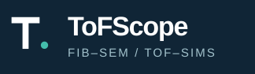
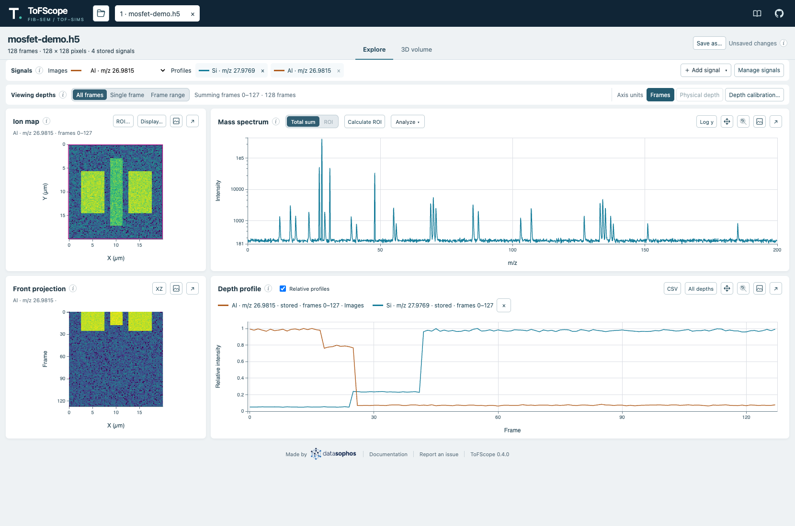
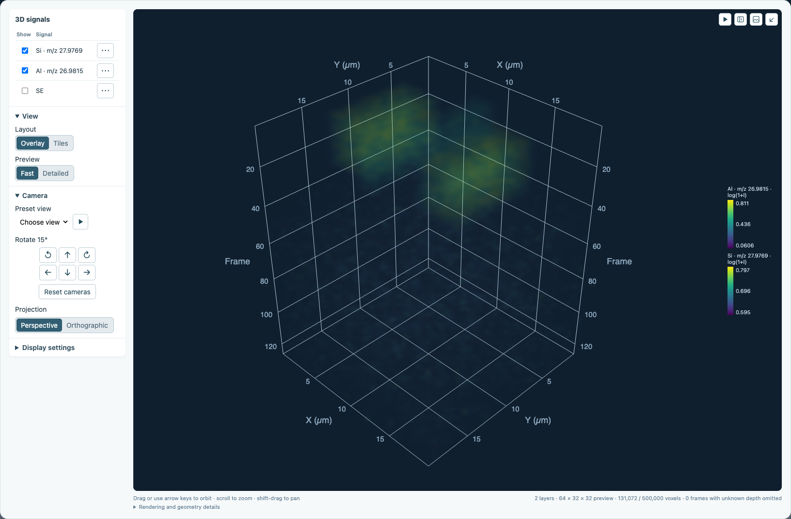
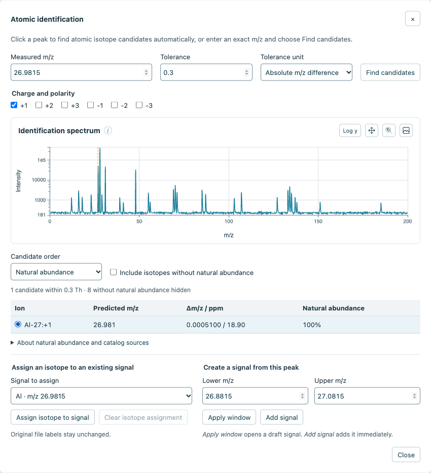

<p align="center">
  
</p>

# ToFScope

[](https://pypi.org/project/tofscope/)
[](https://datasophos.github.io/ToFScope/)

ToFScope is a browser-based application for exploring time-of-flight secondary ion mass spectrometry (ToF-SIMS) data. It allows you to analyze ion images, mass spectra, and depth profiles together so you can inspect an acquisition, compare signals, and save your analysis for later.

ToFScope runs locally on Windows, macOS, and Linux as a Python application and opens in your browser. It reads TOFWERK TOFexplorer[^trademark] HDF5 (`.h5`) acquisitions, and provides interactive tools for exploring their mass spectra, ion images, and depth profiles in two and three dimensions.

**[Read the ToFScope documentation](https://datasophos.github.io/ToFScope/)** for installation, user guides, deployment, and developer information. Start with [Install and launch](https://datasophos.github.io/ToFScope/docs/getting-started/installation.html) or [Your first analysis](https://datasophos.github.io/ToFScope/docs/getting-started/first-analysis.html).



*Explore view showing an ion map, mass spectrum, front projection, and depth profile for a synthetic demo acquisition.*

## What you can do

- **Explore an acquisition:** view ion maps, a mass spectrum, XZ or YZ front projections, and depth profiles together; choose custom regions of interest and frame range.
- **Calculate a sub-region mass spectrum:** reconstruct the mass spectrum for the selected pixels and frames from raw detection events.
- **Compare signals:** use stored ion channels or define custom mass windows from the spectrum, then compare their profiles.
- **Work with depth:** add calibration anchors to display profiles and projections in physical depth where calibration is known.
- **Inspect peaks and isotopes:** find candidate atomic isotope ions and measure selected signals over a region and frame range.
- **Visualize in 3D:** compare SIMS signals and secondary electron images as volume overlays or tiled views, with histogram-based levels, color, and opacity controls.
- **Keep and share results:** export profiles as CSV or plots as PNG, and save data back into TOFexplorer-compatible `.h5` files.



*3D volume view comparing aluminum and titanium signals across acquisition frames.*



*Atomic identification compares a measured mass-to-charge ratio with candidate isotope ions.*

## Get started

You need Python 3.11 through 3.14, [uv](https://docs.astral.sh/uv/getting-started/installation/), and a folder containing supported TOFexplorer `.h5` files. Install from PyPI:

```sh
uv tool install tofscope
tofscope --data-root /path/to/acquisitions --output-root /path/to/saved-analyses
```

On Windows, the runtime directory inherits its permissions from its parent; keep it within a directory
restricted to your Windows account.

Replace the example paths with your folders. The output folder must be writable and have enough space for a full copy of an acquisition. ToFScope starts a local service and opens the app in your browser. Select a file to begin; keep the terminal open while you work and press **Ctrl-C** there to stop the app.

**Windows portable release:** download the Windows x64 ZIP from
[GitHub Releases](https://github.com/datasophos/ToFScope/releases), extract it, and
open **ToFScope.exe**. Choose an acquisition folder and click **Start**. Python and
administrator privileges are not required. The executables are unsigned. See the
[Windows launcher and SmartScreen instructions](https://datasophos.github.io/ToFScope/docs/getting-started/installation.html#windows-portable).

For step-by-step installation, folder setup, and troubleshooting, see [Install and launch](https://datasophos.github.io/ToFScope/docs/getting-started/installation.html). ToFScope automatically loads system and user configuration files. To view what settings are active, you can use `tofscope doctor --json`. See the [configuration reference](https://datasophos.github.io/ToFScope/docs/technical-documentation/configuration.html) for settings, and [deployment](https://datasophos.github.io/ToFScope/docs/technical-documentation/deployment.html) for hosted use and containers.

## Your first analysis

1. Open an acquisition and choose a stored signal, or create one from a mass window in the spectrum.
2. Select a frame range and region of interest to explore its ion image, front projection, and depth profile. The front projection is cropped to the region’s horizontal bounds and summed over its vertical bounds. Add other signals to compare profiles.
3. Use **Depth calibration…** if you have known frame-to-depth measurements, or open **3D volume** to explore the signal spatially.
4. Choose **Save as…** to save a new analysis copy. After a restart, open it through **Saved files** to resume your saved work.

Saving leaves the source acquisition unchanged. Unsaved tabs and in-progress calculations do not survive a restart. Some raw files require preparation into a new copy before exploration; ToFScope previews that step and asks for confirmation.

The [user guide](https://datasophos.github.io/ToFScope/docs/getting-started/index.html) covers signals, calibration, exports, isotope identification, saving, and 3D controls in more detail.

## Current limitations

ToFScope is under active development and is in an alpha state. The application may change substantially prior to a stable 1.0.0 release.
See the [user guide](https://datasophos.github.io/ToFScope/docs/getting-started/index.html) for details.
If you have ideas of features to add, or notice any bugs, please open an [issue](https://github.com/datasophos/ToFScope/issues)!

## Developing ToFScope

The frontend is built with React and TypeScript; the service backend uses Python and FastAPI. Node.js is needed to develop or rebuild the frontend, but not to run the packaged application. From a source checkout:

```sh
uv sync --frozen
uv run tofscope --data-root /path/to/acquisitions --output-root /path/to/saved-analyses
```

For frontend and Python checks, build instructions, and distribution validation, see the [developer commands](https://datasophos.github.io/ToFScope/docs/technical-documentation/building-and-testing.html).

For a diagram-led overview of the application, see [ToFScope architecture](https://datasophos.github.io/ToFScope/docs/technical-documentation/architecture.html).

To build or preview the documentation site, see [maintaining the documentation](https://datasophos.github.io/ToFScope/docs/technical-documentation/documentation.html).

## License

ToFScope is available under the [MIT License](https://github.com/datasophos/ToFScope/blob/main/LICENSE).

---

[^trademark]: TOFWERK and TOFexplorer are names owned by [TOFWERK AG](https://www.tofwerk.com/). They are used here solely to identify the products and file formats supported by ToFScope. ToFScope is an independent project and is not affiliated with, endorsed by, or sponsored by TOFWERK AG.
