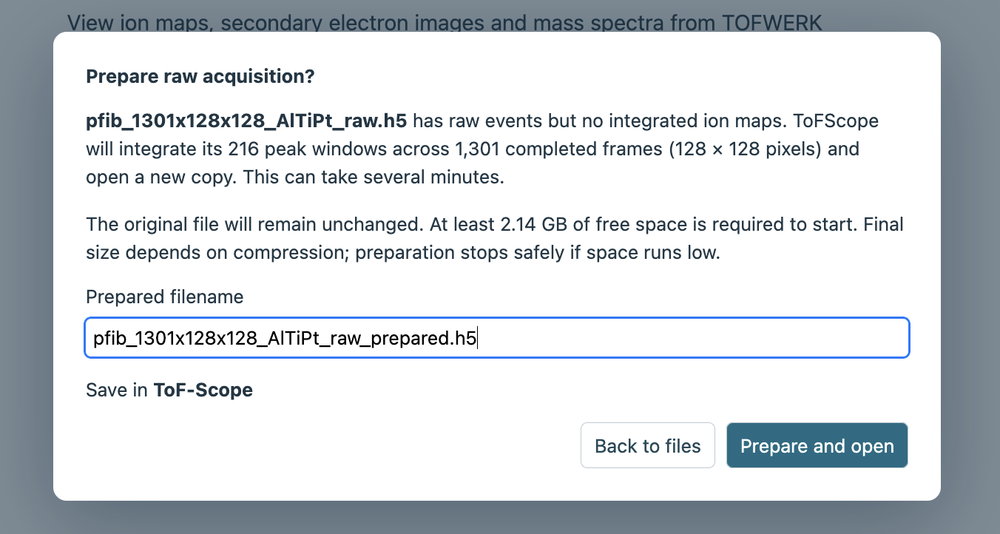

## Opening an acquisition

After [launching ToFScope](01-installation.qmd), you can choose a `.h5` acquisition from the file picker.
You can also open a previous analysis through **Saved files**, which shows the file system relative to whatever
`output-root` you used when running ToFScope. You can open multiple files simultaneously, and they will show in
separate tabs with their own separate analyses.

If the acqusition file was never examined in the commercial software, it will contain only raw TOF events without
any stored ion maps. If this is the case, ToFScope will warn you upon opening the file and allow you to
[prepare](../using-tofscope/15-raw-preparation.qmd) the file before opening. The preview requires confirmation
before ToFScope creates a new copy for exploration, as it can potentially take a few minutes depending on the size
of the acquisition.



## Signals and views

When you open a file, the **Explore** screen displays its signals and linked views. For a new analysis, ToFScope
initially selects the stored signal with the greatest summed-spectrum intensity among peaks centered at m/z 20 or
higher (to avoid common organics at lower m/z values). If no stored peak meets that threshold, it considers all peaks.

In ToFScope, a **signal** represents ion intensity associated with a selected mass-to-charge range across the
acquisition's image pixels and depth frames. It can come from a channel already stored in the file or from one or more
mass windows you define with **Create from spectrum** tool. A mass range can include contributions from more than one
ion, so a signal is not necessarily unique to a particular element or isotope.

The ion image and front projection show the selected signal's spatial distribution, while its depth profile shows how
intensity changes across frames. The mass spectrum helps you examine peaks and define mass windows. Multiple signals
can be compared in the profile view.

The region of interest and viewing frame range can be changed to focus on part of the acquisition by clicking and dragging
across either the top view or front projection. Additional signals and their profile curves can be shown for comparison.
The [signals and views guide](../using-tofscope/10-signals-and-views.qmd) describes the controls and the distinction between
calculated coverage and viewing range.

## Additional analysis tools

The [depth calibration](../using-tofscope/11-depth-calibration.qmd) tool allows you to set known depth values in physical
units at one or more frames. The application can then interpolate between these "depth anchors" to provide an estimate of
physical depth in the profiles and 3D views. The [Peak identification](../using-tofscope/12-identification.qmd) tool compares
a peak with candidate isotope ions, and the [3D volume](../using-tofscope/13-3d-visualization.qmd) view allows you to
inspect the spatial distribution of selected signals in three dimensions.

## Saving and sharing results

After you have anlayzed your signal to satisfaction, clicking **Save as…** will creates a new HDF5 analysis copy. After
restarting ToFScope, you can reopen that copy through to resume or re-inspect the saved analysis.

CSV (for profiles) and PNG (for images) exports can be used to share selected results. The
[saving and exporting guide](../using-tofscope/14-saving-and-exports.qmd) describes what each output preserves and provides
more detail.

::: {#next-using-tofscope}
[<span class="nav-page-text">Using ToFScope</span><i class="bi bi-arrow-right-short" aria-hidden="true"></i>](../using-tofscope/10-signals-and-views.qmd){.pagination-link}
:::

```{=html}
<script>
document.addEventListener("DOMContentLoaded", () => {
  const fallback = document.getElementById("next-using-tofscope");
  const link = fallback?.querySelector("a");
  const next = document.querySelector("nav.page-navigation .nav-page-next");
  if (link && next) {
    next.appendChild(link);
    fallback.remove();
  }
});
</script>
```
