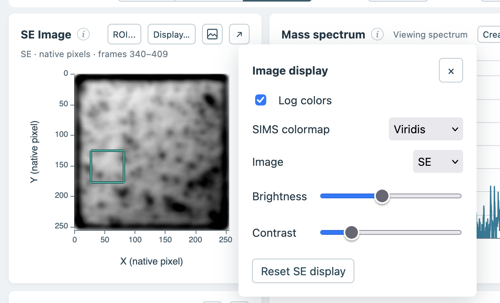

## SE image selection and display

Select, resize, and move the SIMS region of interest directly on the FIB secondary-electron (SE) image. The mapping assumes the SE and SIMS images share the same physical extent, origin, and orientation; this alignment is not verified. Adjust SE brightness and contrast in the Display menu, and reset the image appearance when needed.

## Animated 3D rotation

Use the play/pause controls in the 3D viewer or Camera panel to rotate around the depth axis. Drag, pan, and zoom while animation is active; rotation resumes from the adjusted view. The preview adapts its rendering quality during motion and returns to full detail when paused or exporting an image.

[Watch the 3D camera rotation example (MP4)](https://github.com/datasophos/ToFScope/raw/refs/tags/v0.2.0/docs/release-notes/assets/tofscope-0.2.0-3d-rotation.mp4)
