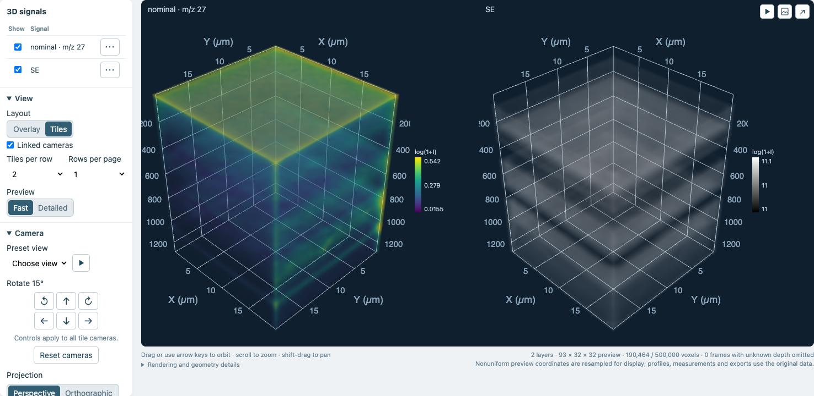
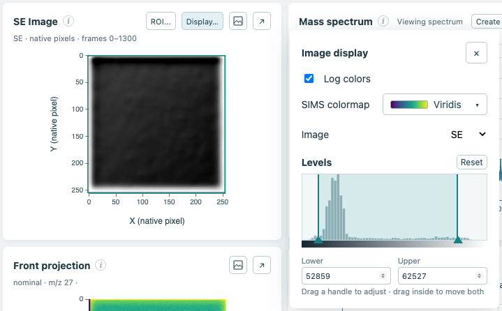
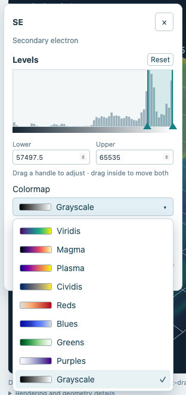

## Secondary-electron images in 3D

ToFScope now supports exploring FIB secondary-electron (SE) images as a 3D layer alongside SIMS signals. SE and SIMS data can be shown together in an overlay or compared them in separate tiles, and the SE layer's colormap, opacity, and levels can be adjusted independently.

SE and SIMS images typically have different pixel dimensions. ToFScope aligns them by assuming the images cover the same physical extent with the same orientation and origin. It does not verify that alignment or correct drift between frames. The selected region of interest and viewing depths apply to both layers.

## Histogram levels and colormap previews

The 3D layer's display range is now adjusted with levels on a histogram, instead of the single "intensity threshold" method used previously. You can drag either handle to set an upper and lower bound, drag between them to move the window, or enter bounds directly. Values below the lower bound are transparent, while color and opacity increase across the window. The reset button restores the automatic range.

The 2D Explore view also uses the same levels control for SE images in place of brightness and contrast sliders. Colormap menus in both Explore and 3D show a preview of each color ramp.

## More flexible tiled views

Choose how many tiles appear per row and how many rows appear per page, for up to 16 layers on a page. Cameras can still be linked across tiles, and additional layers remain available through pagination.

## Faster SE viewing and interface refinements

- SE frame reads now run in parallel when resources permit, reducing the time needed to prepare both Explore images and 3D previews. The calculation still uses the available frames in the selected range.
- Long acquisition names no longer push the Explore and 3D view tabs across the heading. The full filename remains available on hover.
- Image-loading indicators are now centered on the image and use a contrasting background for better visibility.
