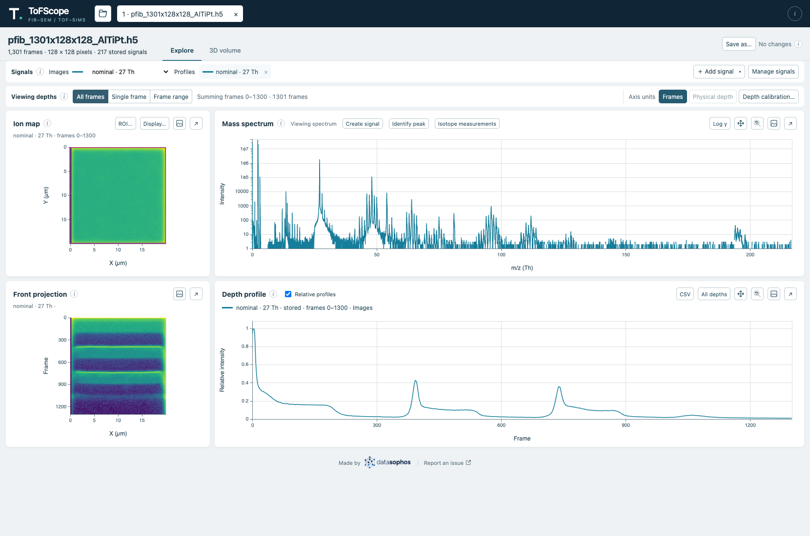

You can open multiple files, including the same file repeatedly, in independent file tabs.
Each analysis has its own named signals, region of interest (ROI), frame coverage, and viewing choices. The **Signals** tray lists stored channels and raw integrations: you can choose
one with **Images** and show or hide additional **Profile** curves. Names and
colors stay with each signal when you switch views.

You can use **Add signal** to search vendor channels, or **Create from spectrum**
to name a raw integration and draw or enter exact inclusive mass intervals. Multiple
intervals form a union. **Calculate signal** adds a result to the tray and profile;
**Images** switches the ion map and front projection explicitly. **Details**
shows provenance and coverage and offers actions to rename or duplicate a signal or edit a custom signal.
Edits stay separate until **Update signal** succeeds; progress, cancellation, and
errors remain visible beside the signal. Failed calculations preserve old results.

**Calculate over frames** defines a signal's coverage. **Viewing depths** chooses
which available frames to show without recalculating the signal. You can choose **All
frames**, **Single frame**, or **Frame range**; only the selected mode's controls
appear. Range edits take effect with **Apply**, and the status describes the
displayed image. Profiles use the full acquisition domain, with gaps outside
signal coverage. **CSV** beside the depth profile controls exports its curves;
a selected frame range limits exported rows.
ROI controls are beside the image; **Display…** contains log colors, the
SIMS colormap, and the SIMS or SE image choice. Viridis is the SIMS default, with
Cividis, Magma, and grayscale available; the palette is saved with the analysis.
SE images retain grayscale. Palette-matched, unfilled ROI outlines and full-width
depth bands preserve image colors. Relative scaling is in the profile header,
and log Y is beside the spectrum. Dragging on the spectrum zooms the view or, while a signal editor is open, edits the active interval. All draft intervals remain numbered on
the spectrum. Bounds display compactly while preserving exact calculation values.
Single clicks preserve zoom; double-click resets the spectrum view. Holding Cmd/Ctrl
and dragging pans a zoomed spectrum or profile horizontally; the **Pan** indicator
lights only on the hovered plot while held. The **Pan** toggle keeps panning enabled; Ctrl/Cmd-wheel zooms.
Images show their full extent. Maximize/Escape preserves the view; ordinary wheel
scrolls the page. The compact header holds file opening and independent file tabs.
Plots have labeled axes, units, and tick marks. Hovering over the spectrum or profile shows the current x coordinate; calibrated profiles also show the nearest frame.
