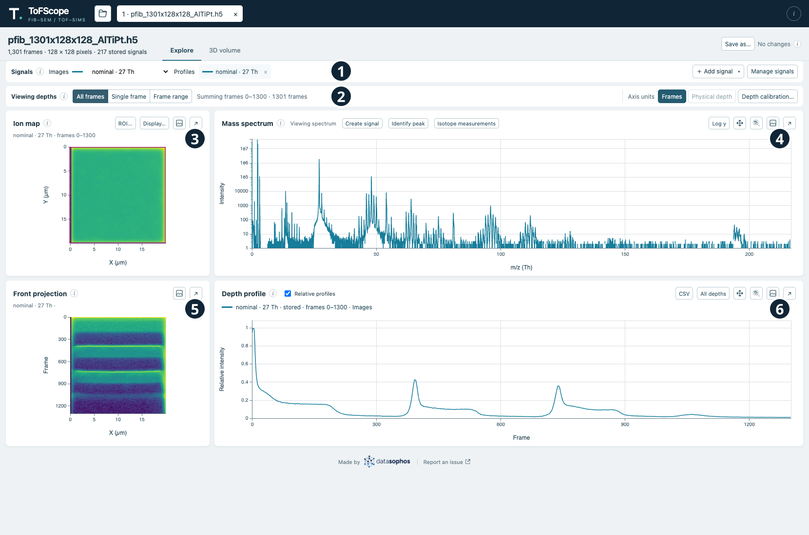
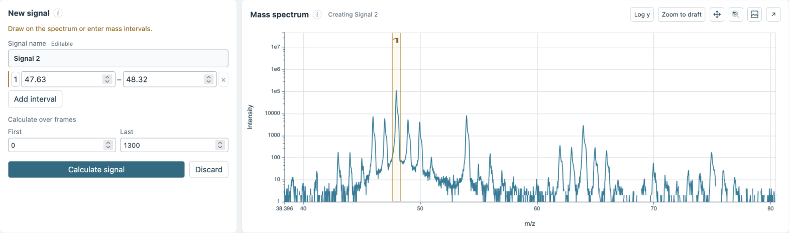
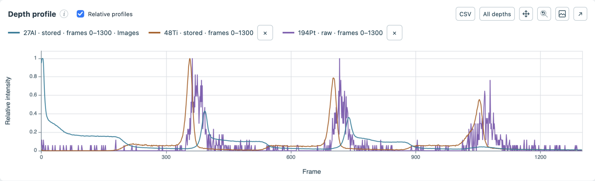
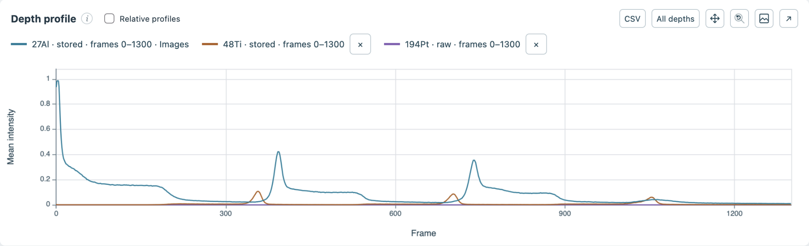

Explore brings signals, images, and plots together in one workspace. You can open multiple files, including the same file more than once, in independent file tabs. Each analysis keeps its own signals, region of interest (ROI), frame coverage, and viewing choices.

## Find your way around

Hover over, focus, or tap a number to see its description.

```{=html}
<div class="explore-overview">
  
  <span id="image-signals" class="explore-highlight" style="left:0.7%;top:11.35%;width:33%;height:4%" aria-hidden="true"></span>
  <span id="image-add-signal" class="explore-highlight" style="left:85.4%;top:11.35%;width:6.5%;height:4%" aria-hidden="true"></span>
  <span id="image-create-signal" class="explore-highlight" style="left:42%;top:21.7%;width:5.5%;height:3%" aria-hidden="true"></span>
  <span id="image-signal-details" class="explore-highlight" style="left:24.5%;top:11.7%;width:8.9%;height:3.3%" aria-hidden="true"></span>
  <span id="image-viewing-depths" class="explore-highlight" style="left:0.7%;top:16%;width:8%;height:4%" aria-hidden="true"></span>
  <span id="image-all-frames" class="explore-highlight" style="left:8.9%;top:16.3%;width:4.4%;height:3.4%" aria-hidden="true"></span>
  <span id="image-single-frame" class="explore-highlight" style="left:13.3%;top:16.3%;width:5.2%;height:3.4%" aria-hidden="true"></span>
  <span id="image-frame-range" class="explore-highlight" style="left:18.5%;top:16.3%;width:5.3%;height:3.4%" aria-hidden="true"></span>
  <span id="image-profile-csv" class="explore-highlight" style="left:83.3%;top:53.3%;width:2.5%;height:3.4%" aria-hidden="true"></span>
  <span id="image-front-projection" class="explore-highlight" style="left:8.4%;top:59.1%;width:12.3%;height:18.7%" aria-hidden="true"></span>
  <span id="image-depth-profile" class="explore-highlight" style="left:31.1%;top:59.8%;width:66.8%;height:18.4%" aria-hidden="true"></span>
  <span id="image-relative-profiles" class="explore-highlight" style="left:35%;top:53.4%;width:7.4%;height:3.3%" aria-hidden="true"></span>
  <span id="image-log-y" class="explore-highlight" style="left:87.5%;top:21.6%;width:2.8%;height:3%" aria-hidden="true"></span>
  <span id="image-spectrum-plot" class="explore-highlight" style="left:31.1%;top:26%;width:66.8%;height:20.5%" aria-hidden="true"></span>
  <span id="image-roi" class="explore-highlight" style="left:14.1%;top:21.6%;width:2.8%;height:3%" aria-hidden="true"></span>
  <span id="image-display" class="explore-highlight" style="left:17.1%;top:21.6%;width:3.9%;height:3%" aria-hidden="true"></span>
  <button type="button" class="explore-marker" style="left:42.17%;top:13.27%" aria-label="1. Signals" aria-describedby="tip-signals"><span role="tooltip" id="tip-signals">Signals selects the signal used for images and the curves shown in the profile.</span></button>
  <button type="button" class="explore-marker" style="left:42.17%;top:18%" aria-label="2. Viewing depths" aria-describedby="tip-depths"><span role="tooltip" id="tip-depths">Viewing depths selects the frames displayed in the images.</span></button>
  <button type="button" class="explore-marker" style="left:24.10%;top:25.91%" aria-label="3. Ion map" aria-describedby="tip-ion-map"><span role="tooltip" id="tip-ion-map">The ion map shows the selected signal across the sample; its controls include ROI and display settings.</span></button>
  <button type="button" class="explore-marker explore-marker-right" style="left:96.39%;top:25.91%" aria-label="4. Mass spectrum" aria-describedby="tip-spectrum"><span role="tooltip" id="tip-spectrum">The mass spectrum shows intensity by mass-to-charge ratio and lets you define a signal.</span></button>
  <button type="button" class="explore-marker" style="left:24.10%;top:57.73%" aria-label="5. Front projection" aria-describedby="tip-projection"><span role="tooltip" id="tip-projection">The front projection shows the selected signal across the sample and through the acquisition frames.</span></button>
  <button type="button" class="explore-marker explore-marker-right" style="left:96.39%;top:57.73%" aria-label="6. Depth profile" aria-describedby="tip-profile"><span role="tooltip" id="tip-profile">The depth profile shows signal intensity through the acquisition frames or calibrated depth.</span></button>
</div>
```

1. [**Signals**]{#overview-signals} selects the signal used for images and the curves shown in the profile.
2. [**Viewing depths**]{#overview-depths} selects the frames displayed in the images.
3. [**Ion map**]{#overview-ion-map} shows the selected signal across the sample; its controls include ROI and display settings.
4. [**Mass spectrum**]{#overview-spectrum} shows intensity by mass-to-charge ratio and lets you define a signal.
5. [**Front projection**]{#overview-projection} shows the selected signal across the sample and through the acquisition frames.
6. [**Depth profile**]{#overview-profile} shows signal intensity through the acquisition frames or calibrated depth.

## Choose or create a signal

The [**Signals**](#image-signals) tray lists stored channels and raw integrations. Choose one in the *Images* picker to
change which ion map and front projection is shown; use the *Profiles* picker to show or hide additional curves on the depth
profile. Signal names and colors stay with each signal when you switch views.

To add a signal:

1. Choose [**Add signal**](#image-add-signal) to search among the nominal channels (or ones previously defined with the
   commercial software, or use [**Create signal**](#image-create-signal) above the spectrum to define a raw integration.
   You can also choose **Create from spectrum** from the Add signal menu.
2. For a raw integration, name it and draw or enter exact inclusive mass intervals. Multiple disjointed intervals
   can be used and will form a union, adding their intensities together.
3. Select [**Calculate signal**](#image-calculate-signal). The result is added to the tray and profile; it will then be available for you to select
   it under **Images** to view that signal's intensity images.

```{=html}
<figure class="figure">
  <div class="explore-overview">
    
    <span id="image-calculate-signal" class="explore-highlight" style="left:1%;top:69%;width:22.5%;height:7.5%" aria-hidden="true"></span>
    <span id="image-calculate-frames" class="explore-highlight" style="left:1%;top:49%;width:28%;height:17%" aria-hidden="true"></span>
  </div>
  <figcaption class="figure-caption">The signal editor and spectrum: the numbered interval on the plot matches the bounds in the editor.</figcaption>
</figure>
```

Select a [signal's profile chip](#image-signal-details) to open its details and see provenance and coverage, rename or
duplicate it, or edit a custom signal. Progress, cancellation, and errors appear beside the signal; a failed calculation
preserves the old result.

## Choose frames to calculate and view

[**Calculate over frames**](#image-calculate-frames) defines the depth range covered by a signal.
[**Viewing depths**](#image-viewing-depths) selects which available frames to display without recalculating it.

To customize the depths shown in the Explore view, choose [**All frames**](#image-all-frames),
[**Single frame**](#image-single-frame), or [**Frame range**](#image-frame-range) from the depth drawer.
The status next to the buttons describes what is being shown in the displayed image. Profiles use the full acquisition
domain, with gaps outside signal coverage.

You can also click the [front projection](#image-front-projection) or [depth profile](#image-depth-profile) to select a single frame,
or click and drag on either plot to select a frame range.

Use the [**CSV**](#image-profile-csv) button beside the depth profile controls to export the values shown in the plot to a CSV file.
If a frame range is selected, the export will be limited to that range.

## Adjust the image and plots

The ion map's [**ROI**](#image-roi) button allows you to select a region of interest. The ROI can also be set by clicking and
dragging directly on the ion map image. Setting an ROI will change the integrated intensity shown in the front projection and
depth profiles to only include ions from that region. The [**Display…**](#image-display) button allows you to customize display
settings, such as linear/log color scales, the colormap to use for SIMS data, and the choice to display SIMS ion counts or the
FIB-SE image.

Use the [**Relative profiles**](#image-relative-profiles) checkbox in the depth profile header to control how intensities are shown. When unchecked, the profiles share a mean-intensity scale, so weaker signals can be hard to see. Checking the box scales each profile to its own maximum, making their shapes easier to compare but potentially making noise more visible.

```{=html}
<div class="profile-comparison" role="group" aria-label="Compare profile scaling">
  <input type="radio" name="profile-comparison" id="profiles-relative" checked>
  <label for="profiles-relative">Relative profiles on</label>
  <input type="radio" name="profile-comparison" id="profiles-mean">
  <label for="profiles-mean">Relative profiles off</label>
  <figure class="figure profile-comparison-relative">
    
    <figcaption class="figure-caption">Relative profiles on: each curve is scaled to its own maximum.</figcaption>
  </figure>
  <figure class="figure profile-comparison-mean">
    
    <figcaption class="figure-caption">Relative profiles off: curves share a mean-intensity scale.</figcaption>
  </figure>
</div>
```

Use the [**Log y**](#image-log-y) button beside the spectrum to switch its vertical scale between linear and log scale.
Plot axes include labels, units, and tick marks. Hover over the [spectrum](#image-spectrum-plot) or
[profile](#image-depth-profile) to see the current x coordinate; calibrated profiles will also show the nearest frame.

### Using plot controls

::: {.plot-navigation}

| Action | Result |
|---|---|
| Drag on the mass spectrum | Zoom the view, or edit the active interval while a signal editor is open. |
| Double-click the mass spectrum | Reset its view. A single click preserves the current zoom. |
| Hold Cmd/Ctrl and drag a zoomed spectrum or profile | Pan horizontally. The **Pan** indicator lights on the hovered plot while the key is held. |
| Click the **Pan** button | Keep panning enabled without holding Cmd/Ctrl. |
| Use Ctrl/Cmd-wheel | Zoom a plot. Ordinary wheel scrolling moves the page. |

:::
