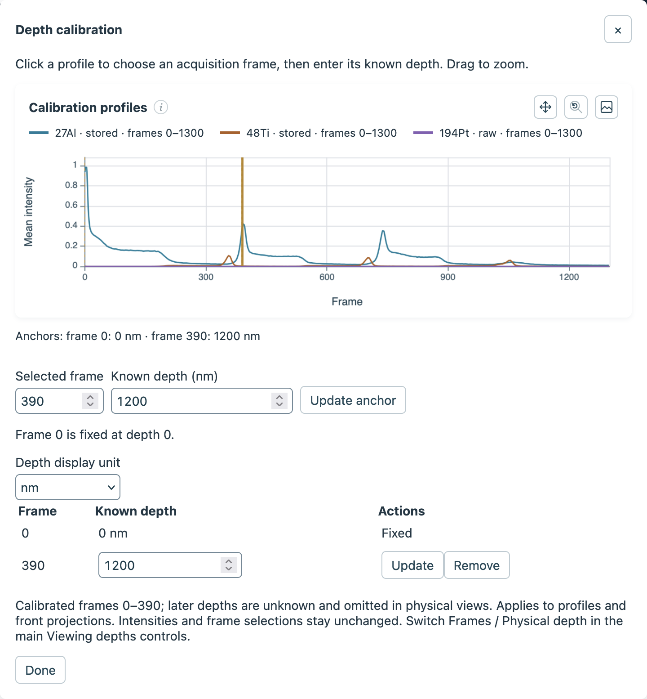

Depth calibration relates acquisition frames to known physical depths. Add one or more reference points, called *anchors*, then choose whether plots use frames or physical depth.

## Open the calibration editor

Select [**Depth calibration…**](#calibration-open) in the **Viewing depths** strip above the plots. The editor opens with a profile in original acquisition frames and controls for entering known depths.

```{=html}
<figure class="figure">
  <div class="explore-overview">
    
    <span id="calibration-open" class="explore-highlight" style="left:91%;top:16.3%;width:7.8%;height:3.5%" aria-hidden="true"></span>
    <span id="calibration-axis-units" class="explore-highlight" style="left:81%;top:16.3%;width:10%;height:3.5%" aria-hidden="true"></span>
    <span id="calibration-csv" class="explore-highlight" style="left:83.3%;top:53.3%;width:2.5%;height:3.4%" aria-hidden="true"></span>
  </div>
  <figcaption class="figure-caption">The Viewing depths strip contains the depth-calibration and axis-unit controls.</figcaption>
</figure>
```

## Add calibration anchors

1. Click a position on the editor's [calibration profile](#calibration-profile) to select an acquisition frame, or enter its exact number in [**Selected frame**](#calibration-frame).
2. Enter its [**Known depth**](#calibration-known-depth) in the displayed unit and select [**Add anchor**](#calibration-add-anchor).
3. Repeat for any additional reference points. Select [**Done**](#calibration-done) when finished.

```{=html}
<figure class="figure">
  <div class="explore-overview">
    
    <span id="calibration-profile" class="explore-highlight" style="left:13%;top:22.5%;width:81%;height:16%" aria-hidden="true"></span>
    <span id="calibration-frame" class="explore-highlight" style="left:2%;top:52.7%;width:14.5%;height:6.6%" aria-hidden="true"></span>
    <span id="calibration-known-depth" class="explore-highlight" style="left:17%;top:52.7%;width:29%;height:6.6%" aria-hidden="true"></span>
    <span id="calibration-add-anchor" class="explore-highlight" style="left:46%;top:55.2%;width:17%;height:4.2%" aria-hidden="true"></span>
    <span id="calibration-unit" class="explore-highlight" style="left:2%;top:65%;width:18%;height:6.7%" aria-hidden="true"></span>
    <span id="calibration-anchor-table" class="explore-highlight" style="left:2%;top:72%;width:77%;height:11%" aria-hidden="true"></span>
    <span id="calibration-done" class="explore-highlight" style="left:2%;top:93.5%;width:8.5%;height:4.2%" aria-hidden="true"></span>
  </div>
  <figcaption class="figure-caption">The editor shows an anchor at frame 390 with a known depth of 1200 nm.</figcaption>
</figure>
```

Frame 0 is fixed at depth 0. Both frame numbers and depths must increase strictly between anchors. To change or remove an anchor, use the controls in the [anchor table](#calibration-anchor-table); removing all positive anchors restores frame coordinates. When an existing anchor is selected, the editor shows **Update anchor** in place of **Add anchor**, as in the image above.

## Choose how depth is displayed

In the editor, [**Depth display unit**](#calibration-unit) selects nm, µm, or mm. In the main Viewing depths strip, use [**Frames** or **Physical depth**](#calibration-axis-units) to choose the coordinates shown on plots.

Physical profiles and front projections show only frames between the anchors; depths beyond the calibrated range remain unknown. Selection and keyboard navigation continue to use the original acquisition frames. Changing the display units does not resample the intensities.

## Export and interpret calibrated depths

The depth profile's [**CSV**](#calibration-csv) export includes `depth_nm` in nanometres, even when the plots display frames. Depth values are blank where they are unknown.
