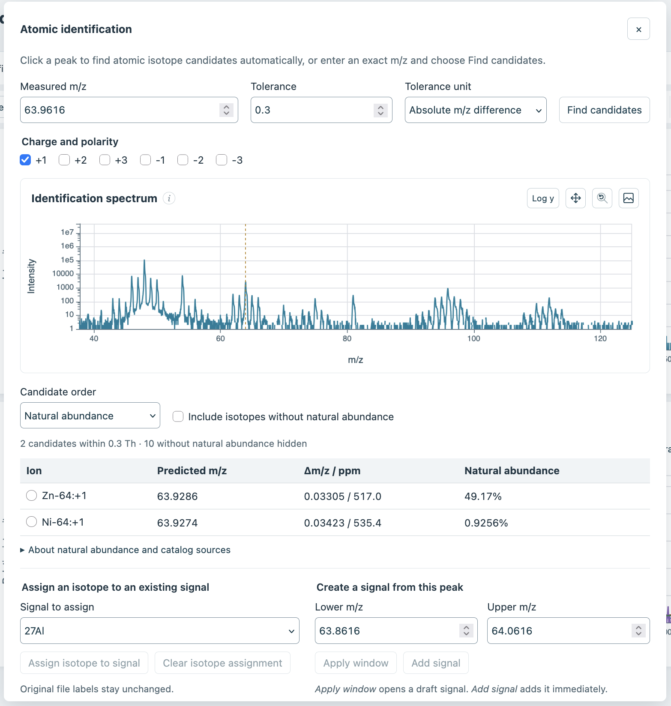
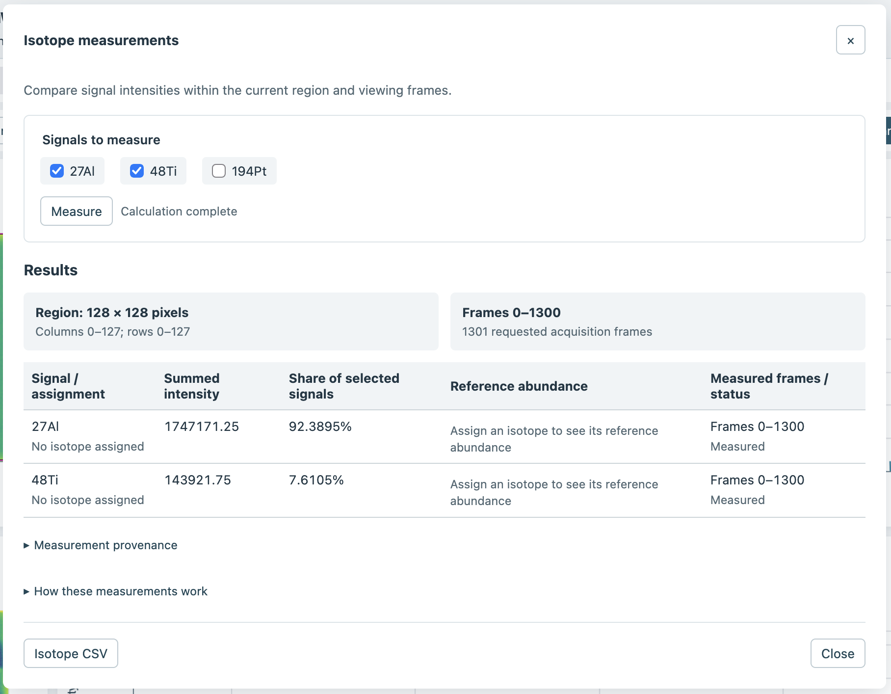

The peak identification tool helps to identify a peak by comparing its measured mass-to-charge ratio (m/z) with a
catalog of atomic isotope ions. You can then associate a candidate with a signal or create a signal from the peak.
Isotope measurements compare selected signals within the current region and viewing frames.

::: {.callout-warning}
## Important Limitations

The catalog searches **single-atom isotope ions only**. It does not suggest molecular or cluster ions,
such as a dimer (two atoms of the same element), ions containing hydrogen or hydroxyl groups, or organic
molecular fragments. The charge and polarity filters do include multiply charged *single atoms*, which are
different from dimers.

Different species can have similar or overlapping m/z values. A listed atomic candidate is therefore a possible
match, not a confirmed identification, and an unlisted molecular ion could contribute to the same peak. Consider
other peaks, isotope patterns, mass resolution, and independent evidence when interpreting a result. Measured
signal shares are not quantitative composition. See this
[review of mass interference in FIB-TOF-SIMS](https://pmc.ncbi.nlm.nih.gov/articles/PMC10003971/) for more detail.
:::

## Open the identification tools

Use [**Identify peak**](#identification-open) or [**Isotope measurements**](#measurement-open) above the mass spectrum.

```{=html}
<figure class="figure">
  <div class="explore-overview">
    
    <span id="identification-open" class="explore-highlight" style="left:47.8%;top:21.6%;width:5.1%;height:3%" aria-hidden="true"></span>
    <span id="measurement-open" class="explore-highlight" style="left:53.5%;top:21.6%;width:8.5%;height:3%" aria-hidden="true"></span>
  </div>
  <figcaption class="figure-caption">Open identification and isotope measurements from the mass spectrum header.</figcaption>
</figure>
```

## Find isotope candidates

1. Open **Identify peak**, then click a peak in the [identification spectrum](#identification-spectrum) to search for potential matches.
   Alternatively, enter an exact [**Measured m/z**](#identification-mz) and select [**Find candidates**](#identification-find).
2. Adjust the [tolerance and its unit](#identification-tolerance), or the [charge and polarity](#identification-charge), to change the search. The default absolute tolerance is 0.3 m/z; changing these settings refreshes the candidates.
3. Review the [candidate table](#identification-candidates), which shows predicted m/z, mass error, and natural abundance. Select a candidate to use it in the actions below.

By default, candidates with known natural abundance are ordered by abundance within the tolerance. Use [**Candidate order**](#identification-order) to choose closest-mass ordering, or include isotopes without tabulated natural abundance. The identification spectrum starts with a logarithmic intensity scale; source and reference information are available in the dialog.

```{=html}
<figure class="figure">
  <div class="explore-overview">
    
    <span id="identification-mz" class="explore-highlight" style="left:3%;top:11.5%;width:33%;height:6%" aria-hidden="true"></span>
    <span id="identification-tolerance" class="explore-highlight" style="left:37%;top:11.5%;width:45%;height:6%" aria-hidden="true"></span>
    <span id="identification-find" class="explore-highlight" style="left:83%;top:13.5%;width:14%;height:4%" aria-hidden="true"></span>
    <span id="identification-charge" class="explore-highlight" style="left:3%;top:19%;width:34%;height:5%" aria-hidden="true"></span>
    <span id="identification-spectrum" class="explore-highlight" style="left:3%;top:25%;width:94%;height:28%" aria-hidden="true"></span>
    <span id="identification-order" class="explore-highlight" style="left:3%;top:54.5%;width:21%;height:6.5%" aria-hidden="true"></span>
    <span id="identification-candidates" class="explore-highlight" style="left:3%;top:64.5%;width:94%;height:12%" aria-hidden="true"></span>
    <span id="identification-assign" class="explore-highlight" style="left:3%;top:82%;width:42%;height:14%" aria-hidden="true"></span>
    <span id="identification-create" class="explore-highlight" style="left:47%;top:82%;width:50%;height:14%" aria-hidden="true"></span>
  </div>
  <figcaption class="figure-caption">The identification dialog compares a measured peak with isotope candidates.</figcaption>
</figure>
```

## Assign or create a signal

After selecting a candidate, you can choose one of these actions:

- [**Assign an isotope to an existing signal**](#identification-assign): choose a signal and select **Assign isotope to signal**.
  This records the candidate and reference information for isotope measurements and saved analyses; it does not change the signal's name,
  mass window, or intensities, or confirm the identification.
- [**Create a signal from this peak**](#identification-create): enter the mass window and select **Apply window** to open an
  assigned draft that you can tweak further, or **Add signal** to immediately calculate a new signal across all acquisition frames.

## Measure isotope signals


::: {.callout-warning}
Isotope measurement is a pre-alpha feature and has not been thoroughly tested.
If this is a feature you are interested in helping to test, please [contact us](https://github.com/datasophos/ToFScope/issues)!
:::

1. Open **Isotope measurements** and choose the [signals to measure](#measurement-signals).
2. Select [**Measure**](#measurement-run). Results use original-resolution data over the current ROI and viewing frames, restricted to the signals' common coverage.
3. Review the [percentage shares and results](#measurement-results), [region and frame summary](#measurement-scope), and any explanations for zero intensity or missing isotope assignments. Expand the [calculation details and provenance](#measurement-details) for more information.

```{=html}
<figure class="figure">
  <div class="explore-overview">
    
    <span id="measurement-signals" class="explore-highlight" style="left:4.2%;top:18.8%;width:27%;height:8.4%" aria-hidden="true"></span>
    <span id="measurement-run" class="explore-highlight" style="left:4.4%;top:28%;width:8.4%;height:4.5%" aria-hidden="true"></span>
    <span id="measurement-scope" class="explore-highlight" style="left:2.5%;top:42%;width:95%;height:8.7%" aria-hidden="true"></span>
    <span id="measurement-results" class="explore-highlight" style="left:2.5%;top:52%;width:95%;height:23%" aria-hidden="true"></span>
    <span id="measurement-details" class="explore-highlight" style="left:2.5%;top:77%;width:23%;height:10%" aria-hidden="true"></span>
    <span id="measurement-csv" class="explore-highlight" style="left:2.5%;top:92%;width:11%;height:5%" aria-hidden="true"></span>
  </div>
  <figcaption class="figure-caption">A measurement compares two selected signals across the displayed region and frames.</figcaption>
</figure>
```

The results describe ratios within the selected signal set; they are not quantitative composition. Fractions are suppressed
when mass windows overlap. If inputs change, captured measurements are marked out of date until you select **Measure** again.

[**Isotope CSV**](#measurement-csv) exports the measurement scope, mass errors, uncertainties, and provenance.
**Save as** and reopening the saved analysis also preserve isotope assignments and captured results.
