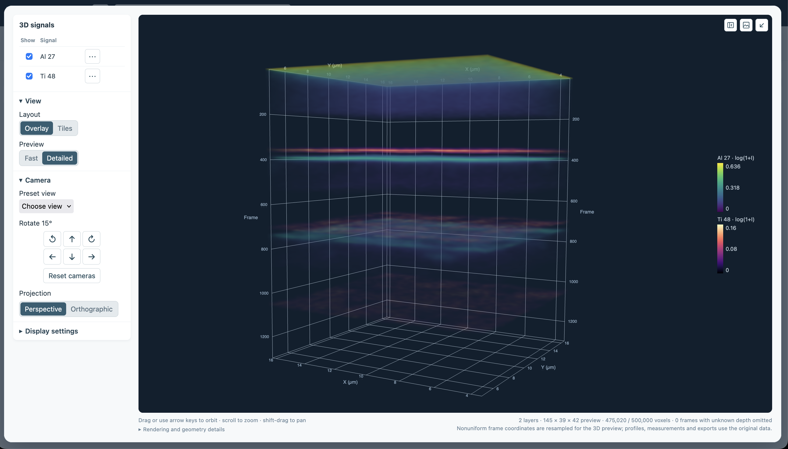
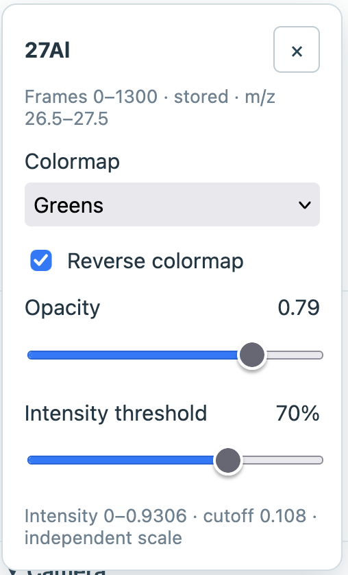
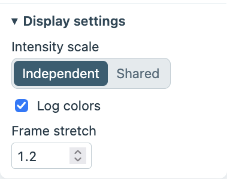

The **3D volume** view displays existing named signals through the acquisition, either together as an overlay or separately in tiles. Use it to explore spatial and depth patterns; the displayed volume is a downsampled preview.

## Choose signals and a layout

The [**3D signals**](#volume-signals) list contains all the named signals in your data. The current image signal is initially
shown. Select the signals to display, then open a signal's [settings](#volume-signal-settings) to adjust its
[colormap](#volume-colormap), [opacity](#volume-opacity), and [intensity threshold](#volume-percentile).
For example, a 70% threshold hides the weakest 70% of positive preview values, making stronger features easier to see while
potentially hiding weaker intensities within the signal.

By default, all signals are stacked on top of each other in the *Overlay* view. You can select [**Overlay** or **Tiles**](#volume-layout)
under **View** to change this setting. Tiles will show up to four signals per page side by side for comparison. Transparent overlays are
qualitative and can hide one signal behind another; inspect a single signal or use tiles to investigate occlusion.

You can choose [**Fast** or **Detailed**](#volume-quality) under **View** to control the level of detail in the 3D view.

```{=html}
<figure class="figure">
  <div class="explore-overview">
    
    <span id="volume-signals" class="explore-highlight" style="left:1.8%;top:3.4%;width:14.7%;height:17%" aria-hidden="true"></span>
    <span id="volume-signal-settings" class="explore-highlight" style="left:10.7%;top:10.8%;width:2.2%;height:8%" aria-hidden="true"></span>
    <span id="volume-layout" class="explore-highlight" style="left:2.3%;top:24.5%;width:7.8%;height:6%" aria-hidden="true"></span>
    <span id="volume-quality" class="explore-highlight" style="left:2.3%;top:31%;width:7.8%;height:6%" aria-hidden="true"></span>
    <span id="volume-camera" class="explore-highlight" style="left:2%;top:38.5%;width:14%;height:33%" aria-hidden="true"></span>
    <span id="volume-display-settings" class="explore-highlight" style="left:2%;top:71.5%;width:14%;height:4%" aria-hidden="true"></span>
    <span id="volume-preview" class="explore-highlight" style="left:17.6%;top:3.4%;width:80%;height:88.7%" aria-hidden="true"></span>
    <span id="volume-maximize" class="explore-highlight" style="left:95.8%;top:4%;width:2%;height:3.2%" aria-hidden="true"></span>
  </div>
  <figcaption class="figure-caption">Two signals are shown as an overlay in the 3D volume view.</figcaption>
</figure>
```

```{=html}
<figure class="figure" style="display: block; max-width: 260px; margin: 1rem auto">
  <div class="explore-overview">
    
    <span id="volume-colormap" class="explore-highlight" style="left:7%;top:26%;width:86%;height:22%" aria-hidden="true"></span>
    <span id="volume-opacity" class="explore-highlight" style="left:7%;top:51%;width:86%;height:14%" aria-hidden="true"></span>
    <span id="volume-percentile" class="explore-highlight" style="left:7%;top:69%;width:86%;height:14%" aria-hidden="true"></span>
  </div>
  <figcaption class="figure-caption">Each signal has its own display settings.</figcaption>
</figure>
```

## Adjust the display

Open [**Display settings**](#volume-display-settings) to choose the intensity scale, log colors, and depth exaggeration
or frame stretch.

- [**Independent** and **Shared**](#volume-intensity-scale) control the intensity scale. Independent scales are the default;
  Shared uses one numerical range across visible signals, which can potentially cause strong signals to overwhelm weak ones.
- The upper display limit uses the 99.7th percentile of positive preview intensities. [**Log colors**](#volume-log-colors)
  displays log(1 + intensity) to improve interpretability; depth profiles and exports retain their original numerical intensities.
- **Frame stretch** changes the displayed depth scale linearly. When depth is shown in frames, you can adjust the ratio of depth to X/Y to approximate a known feature's proportions.

```{=html}
<figure class="figure" style="display: block; max-width: 260px; margin: 1rem auto">
  <div class="explore-overview">
    
    <span id="volume-intensity-scale" class="explore-highlight" style="left:4.5%;top:22%;width:72%;height:29%" aria-hidden="true"></span>
    <span id="volume-log-colors" class="explore-highlight" style="left:4.5%;top:53%;width:42%;height:14%" aria-hidden="true"></span>
    <span id="volume-frame-stretch" class="explore-highlight" style="left:4.5%;top:68%;width:42%;height:27%" aria-hidden="true"></span>
  </div>
  <figcaption class="figure-caption">Display settings apply across the 3D view; frame stretch is shown when depth uses frames.</figcaption>
</figure>
```

The current ROI and **Viewing depths** apply to every layer. The 3D view offers **All frames** and **Frame range** to limit
what frames are shown in the 3D preview.

## Moving the camera

Click and drag or use the arrow keys to orbit the [volume](#volume-preview), scroll to zoom, and Shift-drag to pan.
The [**Camera** controls](#volume-camera) offer axis-aligned preset views, rotations in 15° steps,
a **Reset camera** feature, and a toggle between perspective or orthographic projection. Camera controls apply to all
tile cameras. The viewer also has a [maximize button](#volume-maximize) to increase the screen area of the 3D view.

## Technical details of the 3D preview

Fast previews are capped at 96 × 32 × 32; Detailed previews at 160 × 48 × 48. All visible layers share a
500,000-voxel budget, including layers on other tile pages (a voxel is a single cell in the 3D preview —
a three-dimensional pixel). These limitations are aimed at keeping the application responsive with large datasets.

The preview usually shows each signal as a continuous 3D volume. Some selections, such as a single thin layer or a
signal with missing data, are shown as individual points instead. When the preview combines nearby measurements,
it averages only the data that are available; missing data are not filled in.

If measurements are unevenly spaced, ToFScope may estimate values between them to draw the 3D preview and will
show a warning. Very wide, narrow, or deep views can also lose fine detail; a warning appears when detail may be missed.

When viewing data with calibrated depth, frames with unknown depths are left out of the preview. The preview combines
nearby frames and averages their known depths, including across calibration anchors. Profiles, measurements,
and exports still use the original-resolution data.

After customizing a 3D view, using the **Save as** button to save a ToFScope analysis will preserve layer styles,
layout, page, scale, cameras, and display settings.
