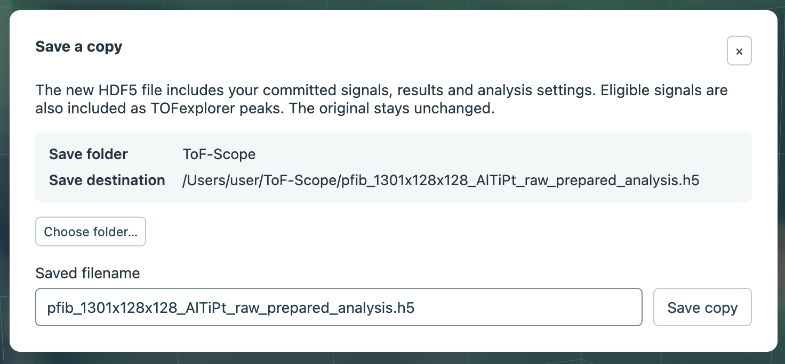
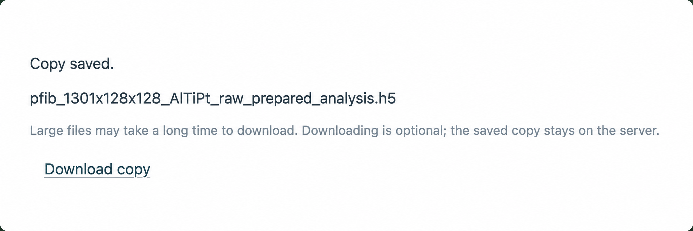

Use the **Save as…** button in the top right corner to create a self-contained analysis copy that you can reopen later.
If you want to share a specific profile, image, or plot, use the CSV or PNG buttons instead.

## Save an analysis copy

1. Finish or discard any signal drafts, and wait for calculations to finish or cancel them.
2. Select [**Save as…**](#save-button). Review the [destination](#save-destination) and choose [**Choose folder…**](#save-choose-folder) if you want a different available folder.
3. Enter a [filename](#save-filename) and select [**Save copy**](#save-confirm). Existing files are not allowed to be overwritten.

```{=html}
<figure class="figure">
  <div class="explore-overview">
    
    <span id="save-button" class="explore-highlight" style="left:89%;top:6.5%;width:4.4%;height:3.3%" aria-hidden="true"></span>
    <span id="save-profile-csv" class="explore-highlight" style="left:83.3%;top:53.3%;width:2.5%;height:3.4%" aria-hidden="true"></span>
    <span id="save-image-png" class="explore-highlight" style="left:21.2%;top:21.5%;width:2%;height:3.2%" aria-hidden="true"></span>
    <span id="save-profile-png" class="explore-highlight" style="left:94.6%;top:53.3%;width:2%;height:3.4%" aria-hidden="true"></span>
  </div>
  <figcaption class="figure-caption">Save the analysis from the header, or export individual views from their plot controls.</figcaption>
</figure>
```

```{=html}
<figure class="figure">
  <div class="explore-overview">
    
    <span id="save-destination" class="explore-highlight" style="left:4.5%;top:36%;width:91.5%;height:19.5%" aria-hidden="true"></span>
    <span id="save-choose-folder" class="explore-highlight" style="left:4.4%;top:59%;width:14.5%;height:9%" aria-hidden="true"></span>
    <span id="save-filename" class="explore-highlight" style="left:4.4%;top:72%;width:78%;height:18%" aria-hidden="true"></span>
    <span id="save-confirm" class="explore-highlight" style="left:83%;top:79%;width:13%;height:11%" aria-hidden="true"></span>
  </div>
  <figcaption class="figure-caption">Review the destination and filename before saving the analysis copy.</figcaption>
</figure>
```

The new HDF5 copy includes the acquisition and committed analysis: signals and full-resolution custom results, including
hidden signals, along with names, colors, ROI, frame and depth selections, calibration, display settings, isotope results,
and 3D view state. The input file stays unchanged, even when it is itself a saved copy.

Saving first creates the copy on the server. After it finishes, [**Download copy**](#save-download) is available if you also
want to transfer it to your computer through a browser download (this is only really relevent if ToFScope is running on a
remote server). The copy remains on the server, and downloading a large file can take time.

```{=html}
<figure class="figure">
  <div class="explore-overview">
    
    <span id="save-download" class="explore-highlight" style="left:6%;top:68%;width:16%;height:11%" aria-hidden="true"></span>
  </div>
  <figcaption class="figure-caption">After saving, the copy can optionally be downloaded.</figcaption>
</figure>
```

## Choose where to save

The acquisition folder for opening files (`--data-root`) defaults to the current working directory. The saved-files
folder (`--output-root`) defaults to the acquisition folder. You should configure a different output root when you need to save
elsewhere or the acquisition folder is read-only.

In the **Save as…** dialog, [**Choose folder…**](#save-choose-folder) lets you browse or create a subfolder under `output-root`.
Local users can choose within the configured acquisition or saved-files folders; hosted users are limited to their private
saved-files folder. Check the full [destination](#save-destination) shown in the dialog before saving.

## Reopen or close an analysis

You can reopen a ToFScope analysis through the **Saved files** pane in the file picker. You can navigate subfolders and
reopen the copy after restarting ToFScope or on another machine. The top Open button opens another file in a new tab.

If you close an analysis with unsaved changes, choose **Save as**, **Discard**, or **Cancel** in the prompt.

## Export a profile or image

- [**CSV**](#save-profile-csv) beside the depth profile exports visible ROI profile curves at their original scale and
  resolution. A selected frame range limits the exported rows.
- The image icon exports a PNG from the [ion map](#save-image-png) or [depth profile](#save-profile-png); profile PNGs
  include labels. Other plot panels also provide PNG export controls.

## TOFexplorer compatibility

ToFScope attempts to save in a format that is cross-compatible with the commercial *TOFexplorer* software, though
this is not guaranteed. Custom signals defined in ToFScope should be readable as named regions in *TOFexplorer*.
For a signal with disjointed mass intervals, the *TOFexplorer* peak uses enclosing bounds and a midpoint that do not
accurately describe the gaps; ToFScope retains the exact intervals.
